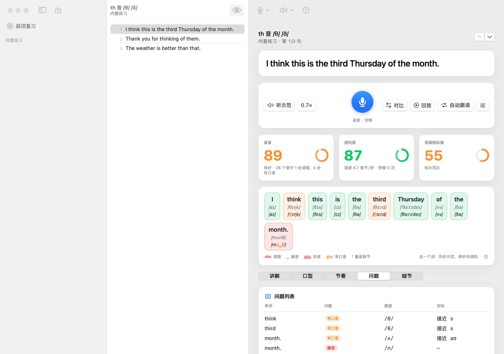
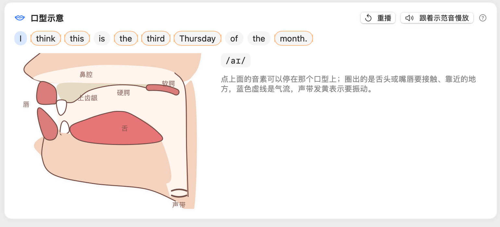
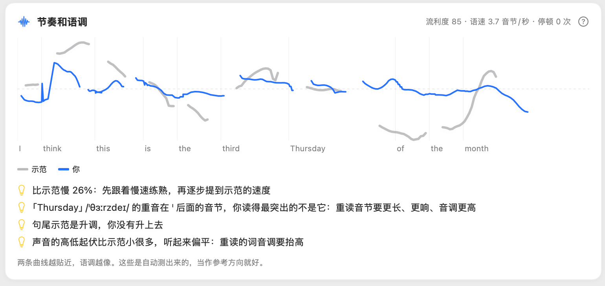

# OpenMouth 跟读教练

在 Mac 上练英语跟读：听一句标准发音，跟着读，马上知道哪个词、哪个音读得不对，以及该怎么改。打分全部在你自己的 Mac 上完成。

*A free English pronunciation (shadowing) coach for Mandarin speakers on macOS. It scores every phoneme on device and explains in Chinese what went wrong and how to fix it, with articulation diagrams and intonation feedback.*

**[⬇︎ 免费下载](https://github.com/GanymedeNil/openmouth/releases/latest)** · **[官网](https://www.ganymedenil.com/openmouth/)** · OpenMouth 是免费软件，禁止出售；如果你是花钱买到的，请找卖家退款。

## 功能

- **精确到每个音的打分**：逐词逐音比对，标出读错、漏读和有口音的地方，并告诉你读成了什么音。音标按牛津/有道词典的美音写法显示，ˈ 标在重读音节前。
- **中文讲解**：针对中文母语者最常见的错误给出改法，并建议哪些词值得单独慢读几遍。
- **口型示意**：侧面剖视图演示每个词的发音动作（舌头、嘴唇、下巴、软腭、声带、气流）；读错的音会并排显示「标准」和「你接近」的口型。
- **节奏和语调**：流利度评分，你的音调曲线和示范放在一起对比，并提示语速、停顿、句尾升降和没读出来的重音。
- **对比听**：点一个词，先放示范里的这个词，再放你读的。
- **长句分段和自动跟读**：长句自动切成几段，先分段练再读整句；自动跟读一句接一句地「听示范 → 跟读 → 评测 → 下一句」。
- **弱项复习**：统计你最常读错的音和词，从你的课程里挑出最适合练它们的句子。
- **导入自己的材料**：`.lrc`、`.srt`、`.txt` 字幕，配同名音频就能听原声；自动识别中英对照的译文，数字按读法展开。
- **AI 助手**：通过 MCP 连接 Claude、ChatGPT、WorkBuddy 等，让它分析你的练习数据、给出建议，并生成专项练习直接发到 App 里。
- **换电脑**：一键导出备份，在新 Mac 上导入，合并而不覆盖。

| 口型示意 | 节奏和语调 |
|---|---|
|  |  |

## 下载安装

从 [Releases](https://github.com/GanymedeNil/openmouth/releases) 下载最新的 `OpenMouth-<版本>.dmg`，打开后把 OpenMouth 拖进「应用程序」。安装包用开发者证书签名并经过苹果公证，双击就能打开。

电脑要求：

- Apple 芯片的 Mac（M1 或更新），macOS 14 或更新；
- 第一次打开要联网下载评分模型，约 3.6 GB（支持断点续传），请留出 5 GB 以上的空间；
- 评分时 App 约占 4.5 GB 内存，建议 16 GB 内存。

**怎么确认是官方版本**：官网是 [www.ganymedenil.com/openmouth](https://www.ganymedenil.com/openmouth/)，安装包只从这里的 Releases 发布。App 每次启动都会检查自己的签名，被改过或重新打包过的副本，窗口底部会一直显示「这不是官方发布的 OpenMouth」。菜单「OpenMouth › 关于 OpenMouth 跟读教练」里有作者和官方下载地址。

## 快速上手

1. 左边选一课，中间点一句。
2. 点「听示范」（有原声的课点「原声」）先听一遍；听不清可以打开 0.7× 慢速。
3. 按空格开始录音，读完再按一次空格。
4. 看结果：哪个词、哪个音读得不对，下面有讲解、口型和节奏。点一个词可以对比听。
5. 按 ⌘] 换下一句，或者打开「自动跟读」一句接一句地练。

App 里的「帮助 › OpenMouth 使用帮助」（⌘?）有每个功能的详细说明。

### 导入课程

菜单「文件 › 导入课程…」（⌘O），或者把文件夹拖到左栏。每个含字幕的文件夹成为一门课程，每个字幕文件是一课：

- `.lrc` 带时间轴，配上同名音频，可以只听这一句的原声；`.srt` 同理；`.txt` 一行一句，`Tom: Hello.` 这样的对话会识别说话人。
- 中英对照的文本，中文行会作为译文显示在英文下面。
- 没有音频的课用合成语音示范。

App 不带任何课程内容，请导入你有权使用的材料。

### 连接 AI 助手

菜单「文件 › 连接 AI 助手…」：Claude、ChatGPT、WorkBuddy 的桌面版可以一键添加，其他支持 MCP 的应用复制窗口里的配置即可。之后就可以问「看看我最近的跟读，哪些音最需要练？」，或者「针对我最弱的两个音做一组专项练习，发到 OpenMouth」。

## 隐私

- 打分在本机完成，录音只保存在你的 Mac 上，不会上传。
- 「听示范」的合成语音会把句子文字发给微软 Edge 的在线朗读服务；没有网络时改用 macOS 自带的声音。
- 连接 AI 助手后，你让它读取的练习数据（句子、分数、读错的音）会发给你使用的 AI 服务；录音不会发送。
- 评分模型从 ModelScope 下载。OpenMouth 没有自己的服务器，不收集任何数据。

## 准确度

评分用三个 wav2vec2 音素识别模型在 Apple 芯片的 GPU 上逐音打分。在 [speechocean762](https://huggingface.co/datasets/mispeech/speechocean762)（250 位普通话母语者朗读的 5,000 句英语，每个音素都有专家标注）的测试集上：读错检测 F1 0.54，误报率 1.4%；句子分和专家打分的相关系数 0.64，成年人 0.73。打分和建议是自动生成的，仅供学习参考。

## 反馈

遇到问题或者有建议，请到 [Issues](https://github.com/GanymedeNil/openmouth/issues) 提出，最好附上截图，并说明是哪一句、用的是哪个版本（菜单「关于」里可以看到）。

## 许可

- OpenMouth 是闭源的免费软件，版权归 GanymedeNil 所有，按 [软件许可协议](EULA.md) 使用：可以免费使用和原样分享，禁止出售、修改后再发布。
- App 附带的两个小程序是开源的，源代码就在这个仓库的 [components](components/) 里：
  - `openmouth-g2p`：调用 espeak-ng 把英文转成音标，GPL-3.0-or-later；
  - `openmouth-tts`：生成在线合成示范音，移植自 edge-tts，LGPL-3.0-or-later。
- 用到的第三方软件、评分模型和数据集，以及它们各自的许可，见 [THIRD_PARTY_NOTICES.md](THIRD_PARTY_NOTICES.md)。
